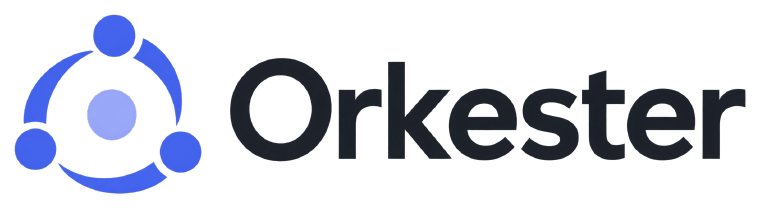

<picture>
  <source media="(prefers-color-scheme: dark)" srcset="docs/orkester-escuro.png">
  
</picture>

**Run a team of coding agents on an infinite canvas — and draw who talks to whom.**


English · [Português](README.pt-BR.md)

Claude Code, Codex and PowerShell run for real inside the cards, next to sticky notes, files and sketches.
The line you draw between two cards is the permission for one agent to talk to the other.

---

## Why

A coding agent handles one task at a time, and handles it well. When the work grows, everyone reaches for the
same answer: open more terminals. At that point the bottleneck stops being the agent and becomes you — half a
dozen identical windows, none of them aware of the others, and the only way for one agent to build on
another's work is for you to copy and paste between them.

Orkester replaces that stack of windows with a canvas. Every terminal becomes a card with a name, a place and
a role; you draw a line between two cards, and from there the agents talk to each other on their own. The
arrangement that used to live only in your head becomes something you can see, save and reuse on the next
project.

Three ideas hold the rest together:

- **The canvas is the state.** Position, name, group and link are not decoration — they are how the app
  decides who can reach whom. Dragging a card inside a group *is* adding it to the team.
- **The link is the permission.** An agent only talks to the agents it is wired to. No loose agent
  broadcasting to the whole board.
- **The agent has hands.** Inside any terminal on the canvas there is the `ork` command: with it an agent
  opens new sessions, delegates, reads the screen of whoever it is linked to, rearranges the canvas and
  assembles its own team. Outside the app, the command refuses to run.

## Features

| | |
|---|---|
| **Real terminals** | Claude Code, Codex or PowerShell inside a card, with scrollback, zoom and copy. They survive workspace switches and resume the conversation when the app reopens. |
| **Delegation** | An agent opens another one already carrying context, waits for the answer, reads the screen, replies to menus and closes what it opened. |
| **Roles** | Name + prompt + folder. An agent is born knowing its part instead of being born empty. |
| **Bands** | Groups drawn as a frame: whoever sits inside talks to everyone else inside. |
| **Scores** | Whole teams saved — agents, roles, briefings, links, bands — raised at once in a new workspace, on any project. |
| **Routines** | A request typed into a card every X minutes, daily or weekly. If the terminal is busy, waiting on a question or finished, the routine skips its turn instead of typing in the middle of the work. |
| **Floors** | Isolated copies of the repository through `git worktree`, so two teams can work on the same project without stepping on each other. |
| **Code trees** | The files an agent touches become cards beside it, with the git diff, grouped by line of work. |
| **Several windows** | Each workspace opens in its own window, and the app reopens the ones you had open, where you had them. |
| **The rest of the canvas** | Sticky notes stored as `.md`, text, attachments, an embedded browser, freehand drawing, undo for everything, light and dark themes. |

## Download

**[Download the installer →](https://github.com/luisgcazeredo/orkester/releases/latest)**

One file, `Orkester-Instalador-1.0.9.exe` (119 MB). Run it and the app installs for your user only — no admin
rights — and puts an **Orkester** shortcut on the desktop and in the Start menu. Requires **Windows 11
x64**; nothing else needs to be installed.

Two things you should know before running it:

- **Windows will warn you.** The installer is not code-signed, so SmartScreen shows "Windows protected your
  PC". Click **More info → Run anyway**. If that bothers you — and it is a fair thing to be bothered by —
  build it yourself from the source instead; the instructions are below.
- **The agents are not included.** Orkester runs the terminals; `claude` and `codex` are separate tools with
  their own accounts, and you install them yourself. Without either, the PowerShell cards still work.

Your boards live in `%USERPROFILE%\.orkester` — the canvas as JSON and sticky notes as `.md`, readable
outside the app — and are not deleted when you uninstall.

Version history: [CHANGELOG.md](CHANGELOG.md).

## Build from source

Requires **Node 24** and **Windows 11 x64**.

```powershell
git clone https://github.com/luisgcazeredo/orkester.git
cd orkester/app
npm install
npm run instalar   # builds the installer and installs the app on this machine
```

For development:

```powershell
npm run dev        # app with hot reload
npm run provas     # unit tests for the pure modules
npm run autoteste  # drives the real app with mouse and keyboard, checks everything, exits (0 = passed)
```

## The `ork` command

Inside any terminal on the canvas, the agent has a command of its own:

```text
ork quem                      who you are and who you are linked to
ork abrir claude|codex|shell  a new session beside you, already linked
ork pedir <name> "…"          send a request and wait for the answer
ork ver <name>                read its screen without sending anything
ork banda criar "Name" …      put a frame around agents so they all talk
ork partitura usar "Name"     raise a saved team beside you
```

Those are six of about twenty-five verbs. **The full reference is in [`docs/ork.md`](docs/ork.md).**

## Under the hood

Electron · React · TypeScript · xterm.js · node-pty.

The canvas logic lives in pure modules, covered by tests that run in plain Node without opening the app. On
top of those, a self-test launches the real app, builds a canvas, drives it with mouse and keyboard and
checks the result on screen. Today: **154 unit tests** and **157 UI checks** across 15 scenarios.

```text
app/src/shared/    pure canvas rules (bands, scores, agent swap, routines, windows, files)
app/src/main/      main process: terminals, `ork` verbs, data on disk, self-test
app/src/renderer/  the canvas, in React
app/src/cli/       the `ork` command the agent calls
docs/              the `ork` reference
```

## Status

Version **1.0.9**, released on 10/11/2026 and in daily use on Windows. Windows 11 x64 only — nothing in the
code assumes otherwise on purpose, but nothing was tested elsewhere either.

## License

No license yet: the code is here to be read, not to be reused. If you want to use any of it, open an issue
and ask.

---

A personal project by [@luisgcazeredo](https://github.com/luisgcazeredo), built for his own use. There is no
promise of support or of compatibility between versions.
